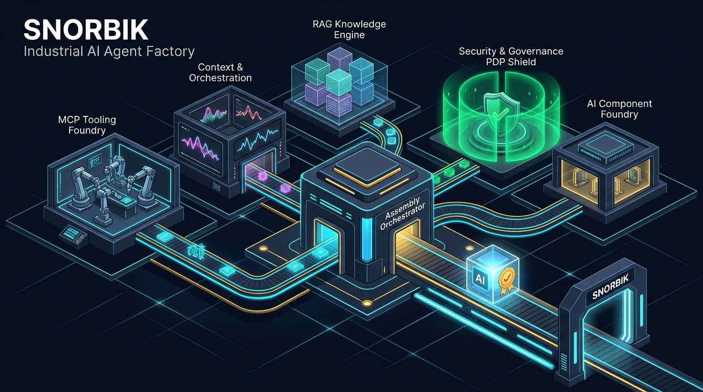
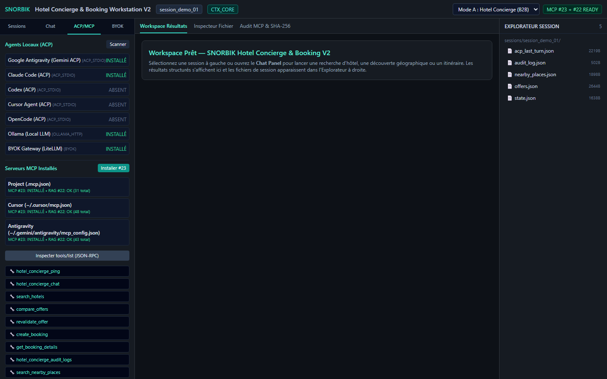
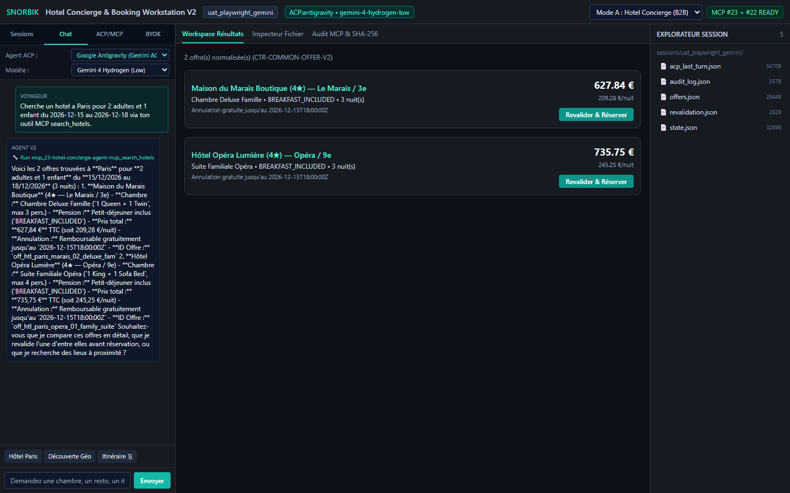
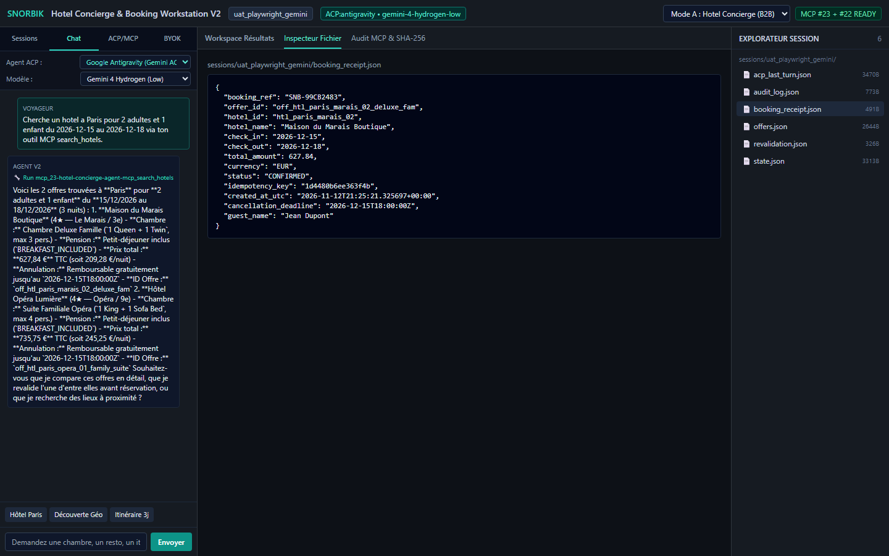

# SNORBIK Industrial AI Agent Factory — Public Showcase

> **Public Showcase Repository** — Architecture overview, MCP & ACP interoperability demonstrations, and AI-readable documentation (`llms.txt`). Proprietary core engines, provider credentials, and internal factory pipelines remain in the private vault (`snorbik-industrial-ai-agent-factory`).

---

## 1. Overview

**SNORBIK Industrial AI Agent Factory** is an industrial platform for manufacturing, validating, and packaging sovereign, reusable AI agents with Clean Architecture boundaries, deterministic Policy Decision Points (PDP), and native **MCP (Model Context Protocol)** + **ACP (Agent Client Protocol)** interoperability.

### Reference Vertical Slice: Hotel Concierge & Booking Agent V2
- **Hotel Booking Intelligence:** Multi-provider offer normalization (`CTR-COMMON-OFFER-V2`), real-time tariff revalidation with TTL `confirm_token`, human-in-the-loop approval (`PDP = ASK`), and idempotent booking confirmation (`BookingReceipt`).
- **Geo Discovery & Travel Intelligence:** Haversine POI filtering (`search_nearby_places`), route calculation (`calculate_distance_and_route`), and multi-day itinerary generation (`build_itinerary`).
- **ACP + MCP Workstation V2:** 3-column VS Code-style cockpit integrating local ACP agents (Google Antigravity Gemini ACP, Claude Code ACP, Ollama, BYOK Gateway), live MCP `#23` tool execution, structured center Workspace cards, and per-session artifact explorer.

---

## 2. Live Workstation & ACP/MCP Screenshots

### ACP Agent Discovery & MCP `#23` (`tools/list`)

### Real Gemini ACP Conversation Invoking `search_hotels` (MCP `#23`)

### Idempotent Booking Confirmation & Session Artifact Explorer

---

## 3. MCP `#23` Workflow Architecture (`23-hotel-concierge-agent-mcp`)

Tools follow the **INV-07 Bipartite Pipeline Doctrine** (structured 5-block descriptions guiding AI agents without rigid state-machine lock-in):

1. **Booking Pipeline:** `search_hotels` ➔ `compare_offers` ➔ `revalidate_offer` ➔ *Human Approval (`PDP = ASK`)* ➔ `create_booking` ➔ `get_booking_details`
2. **Geo & Itinerary Pipeline:** `search_nearby_places` ➔ `calculate_distance_and_route` ➔ `build_itinerary`
3. **Diagnostics & Governance:** `hotel_concierge_ping`, `hotel_concierge_audit_logs`, `hotel_concierge_chat`

---

## 4. Links & AI Discovery

- **Website:** [https://snorbik.com](https://snorbik.com)
- **LLM Index:** [`llms.txt`](llms.txt) • [`llms-full.txt`](llms-full.txt)
- **Organization:** [github.com/snorbik-ai](https://github.com/snorbik-ai)
